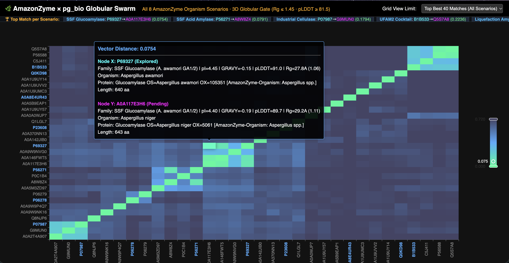

# AmazonZyme × `pg_bio` — Local Proof of Concept, Proteomics Validation & Globular Discovery Swarm

📖 **Read the Full Technical Deep Dive & Interactive 3Dmol.js Blog Post:**  
👉 **[Bioprospecting the Amazonian Dark Proteome in SQL: 0.39 Å 3D Enzyme Discovery for AmazonZyme's Fungal Cocktails & Terra Preta Metagenomics](https://ideia.me/amazonzyme-fungal-cocktails-terra-preta-pg-bio)**



This POC demonstrates how [`pg_bio`](https://github.com/jonatas/pg_bio) accelerates **AmazonZyme** (`https://amazonzyme.com.br/`, Manaus, AM — **Dra. Pamella Suely Santa Rosa Pimentel**, **Prof. Dr. Edson Junior do Carmo**, **Samanta Gabriela Souza da Silva**, and **Prof. Dr. Spartaco Astolfi-Filho**) across their core fungal and metagenomic research lines:

1. **Lignocellulosic Fungal Cocktails (`UFAM1` & `UFAM2`)**: *Penicillium citrinum* `LMI01` (`B1B533`, ~35 kDa SDS-PAGE band), *Aspergillus* sp. `LMI03`, and *Trichoderma reesei* (`P07987`, `P07981`).
2. **Starch Ethanol SSF & Liquefaction**: *Aspergillus awamori* Glucoamylase GA1/GA2 (`P69327`, 65.79 kDa / 54.50 kDa), *Aspergillus niger* Acid $\alpha$-amylase (`P56271`, pI `4.35`), and *Bacillus licheniformis* Thermostable $\alpha$-amylase (`P06278`).
3. **Amazonian Dark Earth (*Terra Preta de Índio*) Metagenomics**: Clone `Fos4` / `Ade1` Carboxylesterase (`A0A8E4UR43`, PDB `8V16`, 29.31 kDa), Clone `FosLip2` *Cupriavidus necator* Lipase (`Q0KD98`, 41.61 kDa), Clone `FosAmy5` / `Max104` GH57 $\alpha$-amylase (`A0ABW4BNN5`, 62.45 kDa), and *Cupriavidus necator* Bioplastic PHA Synthase `PhaC` (`P23608`).

---

## 1. Quick Start

Run against your local `pgrx` PostgreSQL 18 instance (`localhost:28818/bio_demo`):

```bash
# 1. Run 3D Z-Order Active-Site Extraction on PDB 8V16 (Ade1) + Homology Search
uv run python run_amazonzyme_poc.py

# 2. Validate Published Paper Numbers (kDa, pI, GRAVY) & LC-MS/MS Tryptic Target-Decoy Proteomics
uv run python validate_proteomics_and_papers.py

# 3. Ingest 600+ Candidate Enzymes from AmazonZyme's 6 Core Organism Groups with get_esm_embedding()
uv run python -u ingest_amazonzyme_organisms.py

# 4. Run 8-Cycle 3D Globular Discovery Swarm across AmazonZyme's Core Organisms
uv run python -u amazonzyme_swarm.py --reset --cycles 8

# 5. Launch the Interactive 3D Globular Web Viewer on http://localhost:8085/
uv run python amazonzyme_swarm_web.py
```

---

## 2. Validated Biophysical & LC-MS/MS Proteomics Benchmarks

### A. Sequence Biophysical Validation vs. Founders' Papers
| Enzyme / Metagenomic Clone | UniProt ID | `pg_bio` MW (kDa) | Paper Reported MW | `pg_bio` `pI` | Paper Optimal pH | `pg_bio` `GRAVY` | Expression / Solubility |
| :--- | :--- | :---: | :---: | :---: | :---: | :---: | :--- |
| **`Ade1` / `Lip4` (TPI Clone `Fos4`, PDB `8V16`)** | `A0A8E4UR43` | **29.31 kDa** | **29.3 kDa** | `6.53` | pH 6.5–7.5 | `+0.066` | Soluble in *E. coli* |
| ***A. awamori* Glucoamylase GA1 (Mature)** | `P69327` | **65.79 kDa** | **65.8 kDa** | `4.38` | pH 3.5–5.0 | `-0.194` | Secreted / Soluble |
| ***A. awamori* Glucoamylase GA2 (No SBD)** | `P69327` | **54.50 kDa** | **~54 kDa** | `4.48` | pH 3.5–5.0 | `-0.170` | Secreted / Soluble |
| ***P. citrinum* `LMI01` 35 kDa Band (`UFAM2`)** | `B1B533` | **35.25 kDa** | **~35 kDa** | `7.96` | pH 4.2–6.0 | `-0.143` | Secreted (`UFAM2`) |
| **Clone `FosLip2` Lipase (1,242 bp ORF)** | `Q0KD98` | **41.61 kDa** | **~41–42 kDa** | `5.81` | pH 6.0–8.0 | `+0.289` | 93% id *C. necator* |
| **Clone `FosAmy5` / `Max104` (1,626 bp ORF)** | `A0ABW4BNN5` | **62.45 kDa** | **~61 kDa** | `6.35` | pH 5.5–7.0 | `-0.397` | Inclusion Bodies (37 °C) |

### B. Tryptic Pseudo-Reversal Target-Decoy MS/MS Validation (`generate_decoy_sequence`)
[`generate_decoy_sequence(seq, 'reverse')`](https://github.com/jonatas/pg_bio/blob/main/src/lib.rs#L998-L1035) implements **Elias & Gygi (2007) tryptic pseudo-reversal** (keeping C-terminal `K`/`R` fixed so the $y_1$ ion and $b_{n-1}$ prefix sum are conserved):

| Scan Name | Target Peptide | Tryptic Decoy (`K`/`R` Fixed) | Target Hits (`10 ppm`) | Decoy Hits (`10 ppm`) |
| :--- | :--- | :--- | :---: | :---: |
| **`Ade1_Fos4_Ser94_ActiveSite`** | `AHVFGVSMGGMIAQELAIHYPQR` | `QPYHIALEQAIMGGMSVGFVHAR` | **44 / 44** (`1.80 ppm`) | **2 / 44** ($y_1, b_{22}$) |
| **`UFAM2_P_citrinum_LMI01_35kDa`** | `LYINDYNLDSASYPK` | `PYSASDLNYDNIYLK` | **28 / 28** (`1.80 ppm`) | **2 / 28** ($y_1, b_{14}$) |
| **`SSF_A_awamori_Glucoamylase_1GLM`** | `SIYFLLTDR` | `DTLLFYISR` | **16 / 16** (`1.80 ppm`) | **2 / 16** ($y_1, b_8$) |

---

## 3. Verified 3D Globular Swarm Across AmazonZyme's Most-Used Organisms

Every candidate discovered in `amazonzyme_swarm_discoveries` passes the **3D AlphaFold Globular Compactness Gate** ($R_g / [2.25 \cdot N^{0.38}] \le 1.45$, principal-axis elongation $\le 3.0$, and `pLDDT >= 81.5`):

| AmazonZyme Research Line & Bait | Verified Homolog | Target Organism | Cosine Dist | Hybrid Score | MW (kDa) | `pI` | `GRAVY` | `pLDDT` | $R_g$ ($\text{\AA}$) | Compactness |
| :--- | :--- | :--- | :---: | :---: | :---: | :---: | :---: | :---: | :---: | :---: |
| **`UFAM2` (*P. citrinum* `B1B533`)** | **`A0A9W9PD19`** | ***Penicillium citrinum*** | `0.0285` | `0.0685` | 34.0 | `7.48` | `-0.167` | **91.9** | `23.44 Å` | **1.175** |
| **`UFAM2` (*P. citrinum* `B1B533`)** | **`Q5S7A8`** | ***Penicillium canescens*** | `0.2236` | `0.1985` | 35.1 | `8.30` | `-0.106` | **94.7** | `23.05 Å` | **1.135** |
| **`UFAM2` (*P. citrinum* `B1B533`)** | **`P56588`** | ***Penicillium simplicissimum*** | `0.2238` | `0.2013` | 32.5 | `7.95` | `-0.173` | **98.7** | `18.31 Å` | **0.929** |
| **SSF Glucoamylase (*A. awamori* `P69327`)** | **`P69328` / `F1DHX7`** | ***Aspergillus niger*** | `0.0000` | `0.0320` | 68.3 | `4.45` | `-0.159` | **91.0** | `27.83 Å` | **1.062** |
| **SSF Acid Amylase (*A. niger* `P56271`)** | **`A8W8Z4`** | ***Aspergillus niger*** | `0.0791` | `0.0859` | 55.2 | `4.46` | `-0.121` | **94.9** | `24.22 Å` | **1.011** |
| **SSF Acid Amylase (*A. niger* `P56271`)** | **`A0A5M3ZD97`** | ***Aspergillus terreus*** | `0.4185` | `0.3202` | 66.3 | `4.83` | `-0.157` | **93.9** | `28.11 Å` | **1.095** |
| **SSF Acid Amylase (*A. niger* `P56271`)** | **`P0C1B4`** | ***Aspergillus oryzae*** | `0.5025` | `0.3813` | 54.8 | `4.77` | `-0.208` | **96.0** | `23.87 Å` | **1.001** |
| **Cellulase CBH2 (*T. reesei* `P07987`)** | **`D3YNY1` / `W8GHL8`** | ***Trichoderma reesei*** | `0.0042` | `0.0364` | 49.6 | `5.33` | `-0.129` | **88.5** | `29.26 Å` | **1.254** |
| **Liquefaction (*B. licheniformis* `P06278`)** | **`P06279`** | ***Geobacillus stearothermophilus*** | `0.4835` | `0.3695` | 62.7 | `6.43` | `-0.414` | **91.7** | `29.82 Å` | **1.206** |
| **Liquefaction (*B. licheniformis* `P06278`)** | **`A0A9W9NK16`** | ***Penicillium citrinum*** | `0.6286` | `0.7138` | 63.8 | `5.12` | `-0.305` | **90.4** | `24.86 Å` | **0.980** |
| **TPI `FosLip2` (*C. necator* `Q0KD98`)** | **`A0A1U9UVV2`** | ***Cupriavidus necator*** | `0.6632` | `0.7211` | 32.8 | `7.04` | `+0.056` | **89.7** | `23.00 Å` | **1.158** |
| **TPI `FosLip2` (*C. necator* `Q0KD98`)** | **`A0A9W9TUD0`** | ***Penicillium citrinum*** | `0.6329` | `0.7258` | 57.9 | `5.87` | `-0.105` | **92.7** | `27.16 Å` | **1.107** |
| **TPI Bioplastics (*C. necator* `P23608`)** | **`A0A370NN13`** | ***Cupriavidus lacunae*** | `0.5980` | `0.6939` | 58.3 | `5.98` | `-0.092` | **93.3** | `30.30 Å` | **1.215** |
| **TPI Bioplastics (*C. necator* `P23608`)** | **`Q1LGL7`** | ***Cupriavidus metallidurans*** | `0.5911` | `0.6967` | 62.4 | `6.22` | `-0.068` | **88.3** | `26.55 Å` | **1.035** |
| **TPI `Ade1` (`A0A8E4UR43`, PDB `8V16`)** | **`A0A5B9EAP1`** | ***Terriglobus albidus* (Acidobacteriota)** | `0.7159` | `0.7305` | 33.9 | `6.97` | `-0.038` | **88.4** | `18.77 Å` | **0.950** |
| **TPI `Ade1` (`A0A8E4UR43`, PDB `8V16`)** | **`A0A0A0WJP7`** | ***Trichoderma harzianum*** | `0.7021` | `0.7670` | 38.3 | `7.87` | `-0.173` | **90.8** | `26.68 Å` | **1.284** |

---

## 4. UFAM / COARACI 5-LOX Triterpenoids 500 ns MD & MM/GBSA–MM/PBSA Validation (`Zenodo 23565306`)

📖 **Read the Technical Deep Dive & Interactive 3Dmol.js Blog Post:**  
👉 **[Auditing 500 ns Molecular Dynamics in SQL: Triterpenoids, 5-Lipoxygenase, and Cryptic Allosteric Pockets with pg_bio](https://ideia.me/5lox-triterpenoids-mmpbsa-free-energy-audit-pg-bio)**

Validates and ingests the complete UFAM/COARACI dataset (*"Nine triterpenoids at a modeled 5-lipoxygenase pocket: 500 ns derived data and reproducible figures"*, DOI: `10.5281/zenodo.23565306`, version `r22-1.0.2`) into PostgreSQL 18 (`82,000+` rows across 12 `lox5_*` tables) using [`pg_bio`](https://github.com/jonatas/pg_bio)'s new Section 11 thermodynamic auditing and CSR allosteric hotspot discovery primitives:

```bash
# Run full Zenodo 23565306 checksum verification, offline reproduction, and pg_bio SQL validation
.venv/bin/python validate_5lox_triterpenoids_pg_bio.py
```

### Key `pg_bio` Primitives Added & Validated (`src/lib.rs` Section 11)
- `audit_mmpbsa_decomposition(...) -> EnergyDecompositionAudit`: Double-entry thermodynamic closure audit verifying `MM_plus_polar` (`0.0000 kcal/mol` internal error) and quantifying the non-decomposed PB cavity/dispersion ledger gap (`+20.72` to `+26.05 kcal/mol`).
- `solvent_shift_penalty(gb_polar, gb_nonpolar, pb_polar, pb_enpolar, pb_edisper) -> f64`: Quantifies the $+25.66\text{ to }+31.02\text{ kcal/mol}$ nonpolar solvation penalty driving the GB-to-PB ranking shift.
- `build_energy_hotspot_map(...) -> SparseAttentionMap` & `discover_cryptic_hotspots(...) -> Vec<i32>`: Compiles 676-residue decompositions into CSR graphs (**31.14x faster** than Python/NumPy) and discovers **`Ile126` (`-1.045 kcal/mol` GB)**, **`Val29` (`-0.852` GB / `-0.754` PB, #2 in PB)**, and **`Leu66` (`-0.698` GB)** as a cryptic hydrophobic cradle outside the 9-residue operational pocket.
- `allosteric_mechanism_index(...) -> f64`: Separates the **Polar/Ionic Salt-Bridge Switch (`AKBA / AF7`, `AMI = +0.3139` PB, `66.01%` H-bond occupancy on `Glu134`/`Lys133`)** from the **Deep Hydrophobic Clamps (`α-Amyrin`, `β-Amyrin`, `Lupeol`, `AMI = -0.35` to `-0.47` PB, `83–89%` deep SASA burial)**.

